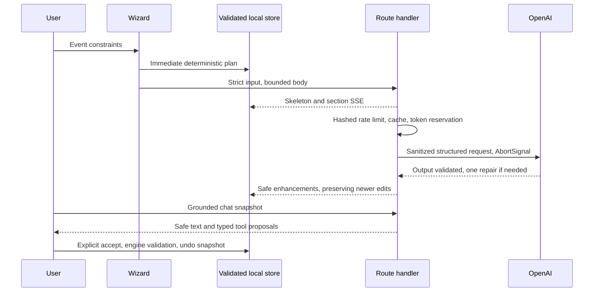

# Architecture

The application uses Next15.5.28 App Router and React19.3, TypeScript strict mode, Tailwind4/PostCSS, Radix dialog, Zustand persistence, Zod schemas, lazy Recharts and official OpenAI SDK.

Domain modules own all arithmetic, phase/date/dependency rules, safety-aware idea seeds and vendor templates. API and export/import boundaries use the same schemas. Client-ready tool definitions/executors import no server credentials. Snapshot transport preserves edited milestone IDs, statuses and budget locks within the32KB request cap. Model failures always leave a usable deterministic plan.

Separate workspace tabs load on demand. The landing is server-rendered; local plans and schema validation load near the saved-plans section. Chart and Markdown packages are lazy. Nonce CSP uses Next15 `middleware.ts` and forces dynamic rendering as required by bundled documentation; cached static HTML with per-request nonces would be incorrect. The offline worker caches public app shells/assets, never API responses or shared payloads, using the postbuild precache list. Cached shells read private plans from localStorage.

`reports/bundle.json` measures gzip scripts actually referenced by the built landing, and scans all browser JavaScript for key patterns. `@next/bundle-analyzer` is configured for optional Webpack visualization via ANALYZE=true; the route budget report works with the production Webpack build. The measured modern-browser initial script total is117583 gzip bytes, within the120KB budget; legacy nomodule polyfills are excluded from the modern download metric but still scanned for secrets. `reports/lighthouse-summary.json` contains measured audit results when available.

Vercel uses the pre-existing project ID and alias, with Mumbai region requested. No database is required. EVAL_SECRET is configured separately from the absent OpenAI key. Memory budgets/rates are only per-process without Redis. Tests exercise SDK HTTP via MSW, property invariants, components, saved tool decisions and all three occasion flows at desktop/mobile widths.

Page shells render on the global Edge runtime with nonce CSP. API handlers explicitly use Node.js in bom1. Evaluation pages import compact build-generated summaries rather than multi-megabyte outputs; full per-case fixture evidence is a same-origin static JSON request on expansion.

The shared static description is emitted directly in the initial head for every user agent because Next 15 Edge rendering streams Metadata API tags into the body. A raw-HTML browser regression verifies the description location without audit-specific user-agent rules.

The generic loading.tsx boundary is scoped to saved-plan routes. A production Lighthouse filmstrip reproduced a home page fallback-to-content replacement with CLS 0.913; the landing now delivers its complete server content instead. A raw-HTML regression rejects the global fallback on home.

## Client boundaries

- `lib/hooks/usePlanActions.ts` owns validated workspace mutations, history, sharing and navigation. `Workspace` renders those actions and lazy section views.
- `lib/hooks/usePlannerChat.ts` owns chat persistence, cancellation, streaming and proposal decisions. `ChatTab` renders messages and review controls.
- `lib/client/storage.ts` is the lightweight browser-storage adapter used by UI preferences. Plan schema migration lives in `lib/client/planStorage.ts` so the global header does not load the planning validation graph.
- `lib/schemas/evaluation.ts` defines the dashboard summary contract. Server snapshots and client evaluation events are validated at their boundaries; detailed evidence remains lazy-loaded.
