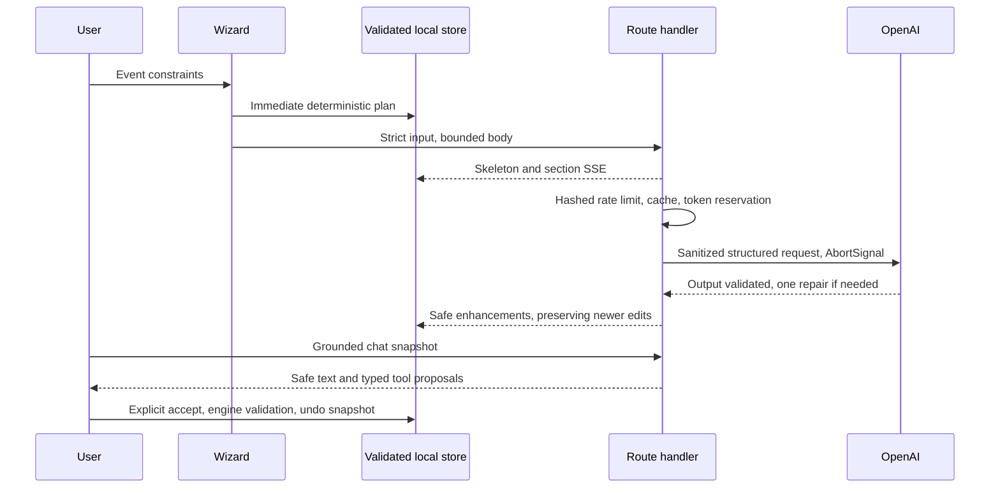

# Architecture

**Follow-up local verification — 28 October 2026:** **298/298 tests across 42 files**, **26/26 desktop/mobile browser checks**, strict TypeScript, lint/formatting, production build and bundle/secret checks passed. The full dependency audit reports zero findings. Whole-application line coverage is **82.96%**, library line coverage **94.83%**, and domain line coverage **98.35%**. The strengthened offline evaluation passes **46/46 cases with zero model calls**. See [the quality report](reports/submission-portability-2026-10-28.json). Fresh production verification retained 62/68 loads below two seconds and 0 runtime/hydration errors; the strict timing gate failed.

Production verification retained all **68 visits**: **62/68 loads below two seconds**, median **1.067 s**, p95 **2.495 s**, maximum **3.154 s**, maximum heading readiness **3.442 s**, and **0 runtime/hydration errors**. The strict two-second gate **failed**. Edge 156.0.4314.50, fresh desktop/iPhone 13 contexts, unthrottled network and verified CDN warmup; release fingerprint stayed unchanged. No sample was retried or discarded. [Production audit](reports/verification-portability-2026-10-28.json). [Previous release evidence](reports/verification-followup-2026-10-28.json) remains historical.

The recorded 25 October release uses Next.js 15.5.28 App Router and React 19.3, TypeScript strict mode, Tailwind 4/PostCSS, Radix dialog, Zustand persistence, Zod schemas, lazy Recharts and the official OpenAI SDK. Release measurements below are dated evidence, not verification of later local changes.

Domain modules own all arithmetic, phase/date/dependency rules, safety-aware idea seeds and vendor templates. API and export/import boundaries use the same schemas. Client-ready tool definitions/executors import no server credentials. Snapshot transport preserves edited milestone IDs, statuses and budget locks within the32KB request cap. Model failures always leave a usable deterministic plan.

Separate workspace tabs load on demand. The landing is server-rendered; local plans and schema validation load near the saved-plans section. Chart and Markdown packages are lazy. Nonce CSP uses Next15 `middleware.ts` and forces dynamic rendering as required by bundled documentation; cached static HTML with per-request nonces would be incorrect. The offline worker caches public app shells/assets, never API responses or shared payloads, using the postbuild precache list. Cached shells read private plans from localStorage.

`reports/bundle.json` measures gzip scripts actually referenced by the built landing, and scans all browser JavaScript for key patterns. `@next/bundle-analyzer` is configured for optional Webpack visualization via ANALYZE=true; the route budget report works with the production Webpack build. The 25 October release report records 117,623 gzip bytes of modern-browser initial scripts, within the 122,880-byte budget; legacy nomodule polyfills are excluded from the modern download metric but still scanned for secrets. See [the dated release report](reports/code-quality-revision.json). The 22 October [Lighthouse summary](reports/lighthouse-submission-summary.json) is historical: home/intake performance medians were 90/85. The later production timing gate failed in both measured browsers; [SUBMISSION.md](SUBMISSION.md) records those results.

Vercel uses the pre-existing project ID and alias, with Mumbai region requested. No database is required. EVAL_SECRET is a separate server-only configuration from OPENAI_API_KEY. One production generation with a configured OpenAI key was verified on 25 October in [the live smoke report](reports/live-submission-smoke.json); live judge and prompt A/B quality results remain unmeasured. Memory budgets/rates are only per-process without Redis. Tests exercise SDK HTTP via MSW, property invariants, components, saved tool decisions and all three occasion flows at desktop/mobile widths.

Page shells render on the global Edge runtime with nonce CSP. API handlers explicitly use Node.js in bom1. Evaluation pages import compact build-generated summaries rather than multi-megabyte outputs; full per-case fixture evidence is a same-origin static JSON request on expansion.

The shared static description is emitted directly in the initial head for every user agent because Next 15 Edge rendering streams Metadata API tags into the body. A raw-HTML browser regression verifies the description location without audit-specific user-agent rules.

The generic loading.tsx boundary is scoped to saved-plan routes. A production Lighthouse filmstrip reproduced a home page fallback-to-content replacement with CLS 0.913; the landing now delivers its complete server content instead. A raw-HTML regression rejects the global fallback on home.

## Client boundaries

- `lib/llm/refinement.ts` defines strict, section-specific deltas. A compact AI snapshot supplies context; it never replaces the full stored section. Acceptance merges only permitted fields and retains custom tasks, completion state, saved ideas and untouched notes.
- `lib/hooks/useSectionRefinement.ts` shares request cancellation and preview acceptance between budget optimization and section regeneration. Accepted changes must belong to the current plan and revision; `usePlanActions` validates again at the mutation boundary.
- `lib/hooks/usePlanActions.ts` owns validated workspace mutations, history, sharing and navigation. `Workspace` renders those actions and lazy section views.
- `lib/hooks/usePlannerChat.ts` owns chat persistence, cancellation, streaming and proposal decisions. `ChatTab` renders messages and review controls.
- `lib/client/storage.ts` is the lightweight browser-storage adapter used by UI preferences. Plan schema migration lives in `lib/client/planStorage.ts` so the global header does not load the planning validation graph.
- `lib/schemas/evaluation.ts` defines the dashboard summary contract. Server snapshots and client evaluation events are validated at their boundaries; detailed evidence remains lazy-loaded.

## Follow-up consistency boundaries

`usePlanGeneration` separates initial streaming from saved-plan retry. A saved retry transports compact context but returns only allowed deltas. The full client plan is retained, then validated and accepted only at the originating revision through one history entry. Fallback responses do not create a preview or overwrite metadata.

Budget warnings use the actual retained allocation in UI and chat. Calendar-only planning deadlines use Asia/Kolkata on every host; event clock times remain venue-local. `calendar.ts` owns date-only arithmetic and deadline clamping.

Evaluation case details are bound to run identity. Only the initial recorded run can fetch static case evidence; missing live output stays explicitly unavailable.

## Portable plans and browser transport

`lib/client/planSnapshot.ts` uses only erased type imports; browser AI requests no longer import template reconstruction. `lib/llm/snapshot.ts` retains server schemas and hydration. Actual rendered home, saved and shared script bytes are budgeted by the bundle audit.

`parsePortablePlan` validates row identity and core money consistency at file import, shared-fragment decoding and storage restoration. It preserves past due dates, custom tasks and recorded progress; date aging alone is not corruption. Repeated persisted plan IDs retain the first valid owner.
