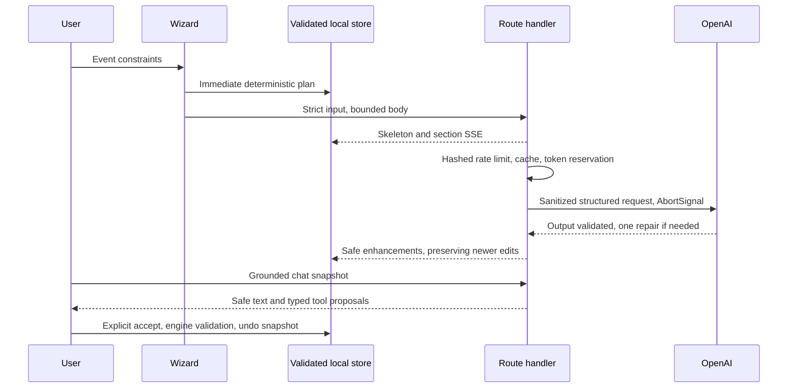

# Architecture

The application uses Next15.5.28 App Router and React19.3, TypeScript strict mode, Tailwind4/PostCSS, Radix dialog, Zustand persistence, Zod schemas, lazy Recharts and official OpenAI SDK.

Domain modules own all arithmetic, phase/date/dependency rules, safety-aware idea seeds and vendor templates. API and export/import boundaries use the same schemas. Client-ready tool definitions/executors import no server credentials. Snapshot transport preserves edited milestone IDs, statuses and budget locks within the32KB request cap. Model failures always leave a usable deterministic plan.

Separate workspace tabs load on demand. The landing is server-rendered; local plans and schema validation load near the saved-plans section. Chart and Markdown packages are lazy. Nonce CSP uses Next15 `middleware.ts` and forces dynamic rendering as required by bundled documentation; cached static HTML with per-request nonces would be incorrect. The offline worker caches public app shells/assets, never API responses or shared payloads, using the postbuild precache list. Cached shells read private plans from localStorage.

`reports/bundle.json` measures gzip scripts actually referenced by the built landing, and scans all browser JavaScript for key patterns. `@next/bundle-analyzer` is configured for optional Webpack visualization via ANALYZE=true; the route budget report works with the production Webpack build. The measured modern-browser initial script total is116998 gzip bytes, within the120KB budget; legacy nomodule polyfills are excluded from the modern download metric but still scanned for secrets. `reports/lighthouse-summary.json` contains measured audit results when available.

Vercel uses the pre-existing project ID and alias, with Mumbai region requested. No database is required. EVAL_SECRET is configured separately from the absent OpenAI key. Memory budgets/rates are only per-process without Redis. Tests exercise SDK HTTP via MSW, property invariants, components, saved tool decisions and all three occasion flows at desktop/mobile widths.
