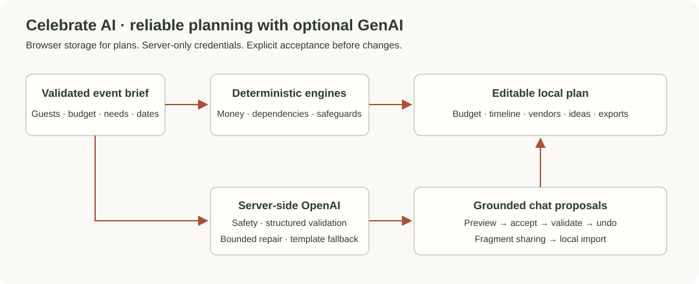
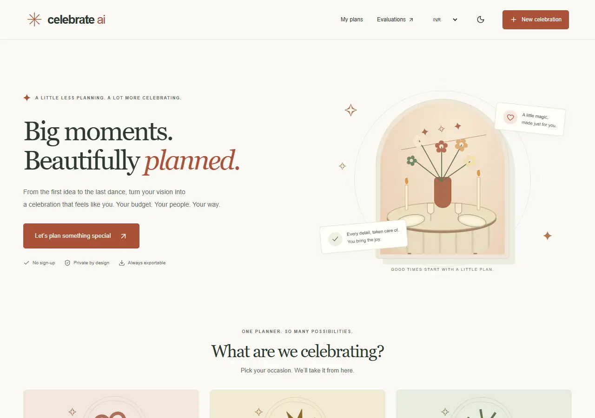
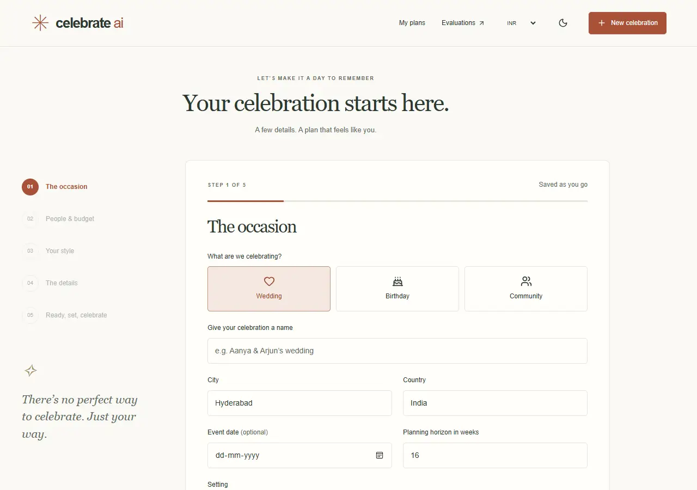
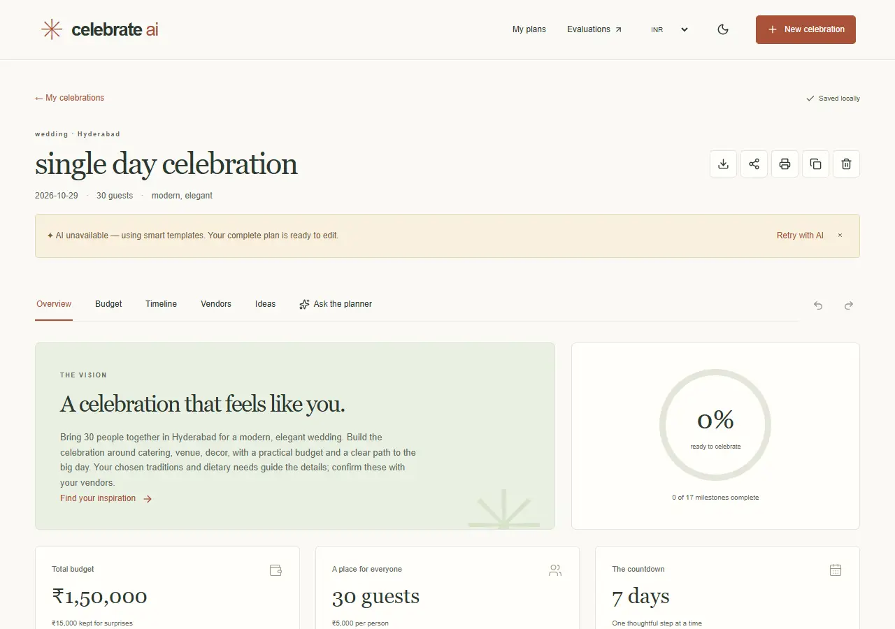
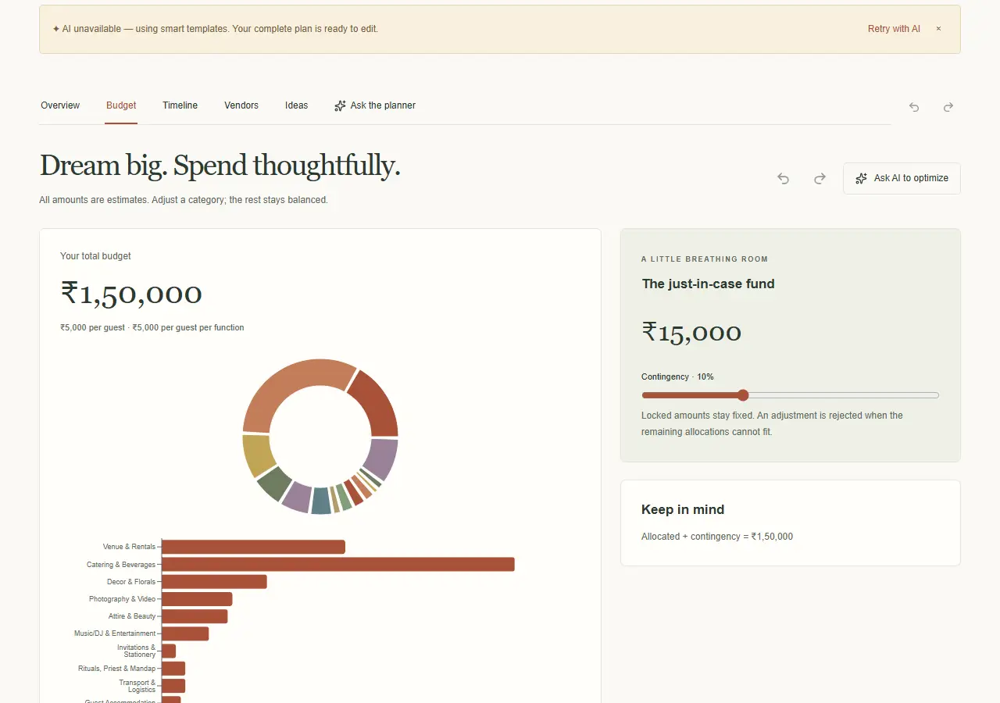
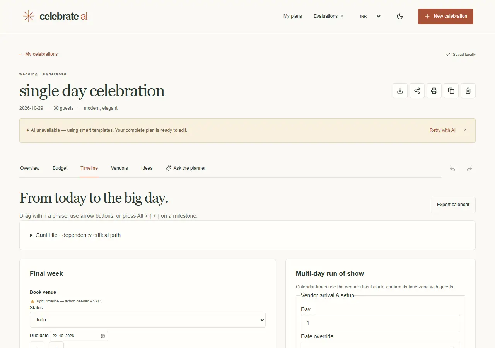
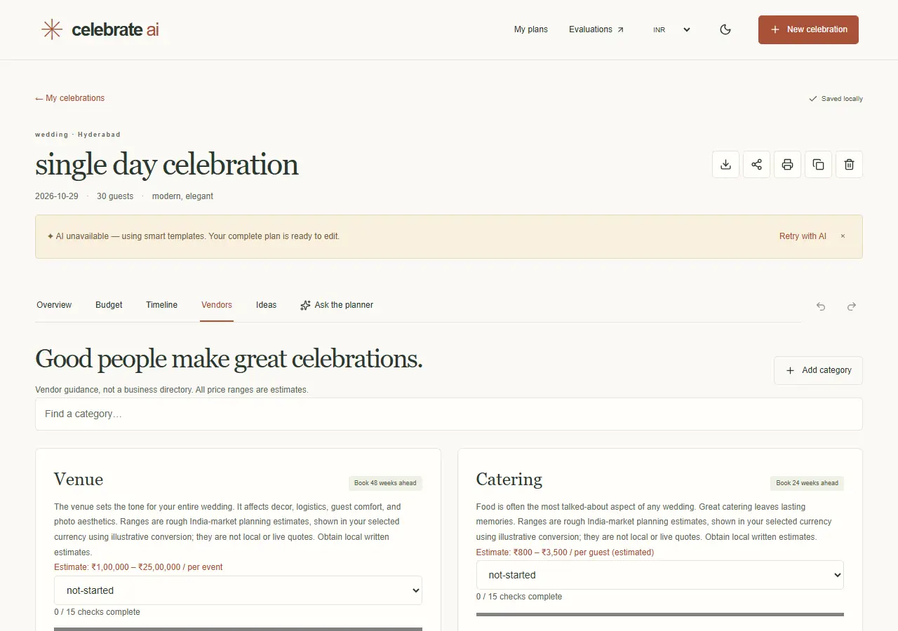
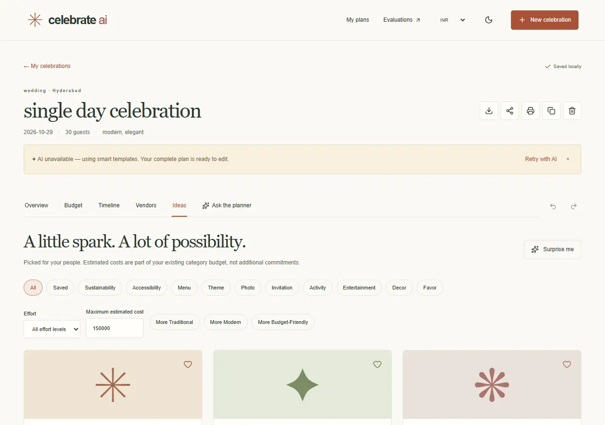
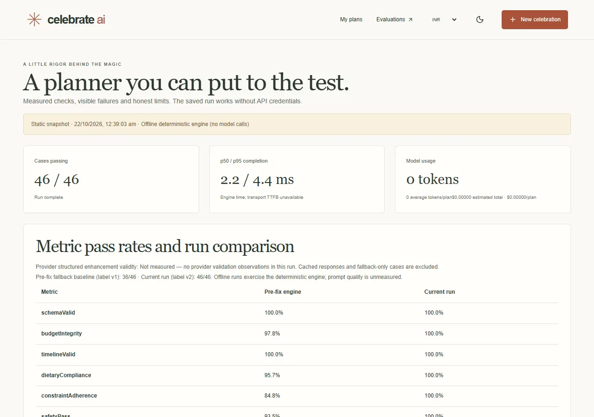

# Celebrate AI

A thoughtful GenAI planning companion for life's celebrations.

Celebrate AI helps people organize weddings, birthdays and community events. It turns an event brief into an editable budget, timeline, vendor checklist and personalized ideas. Server-side AI adds grounded suggestions when configured; deterministic engines keep the plan usable when the provider is unavailable.

Repository: https://github.com/9059Rohith/celebrate-ai-event-planner

## Demo Link

Demo video: [Link](https://drive.google.com/file/d/1hz0frq_4JTFciHmpEchGQP3gOSxKw8S4/view)

The recording is uploaded. Public viewing permission is awaiting the owner's sharing change; judge access is not yet verified.

## Deploy

Live app: [https://celebrate-ai-event-planner.vercel.app/](https://celebrate-ai-event-planner.vercel.app/)

## Privacy-First Architecture



Plans live in browser storage. Only relevant event details and grounded context reach server-side AI routes. Sharing creates a read-only copy in a URL fragment; importing creates an editable local copy.

## Demo

The demo creates a wedding plan from the five-step intake, explores the budget, updates a timeline milestone, checks a vendor task and saves an idea. It then asks the planner to change the guest count, previews the proposal and explicitly accepts it. A read-only share link is opened and imported. Birthday and community plans demonstrate the other occasion flows, followed by evaluation case evidence.

Source badges distinguish templates from AI enhancement. The evaluation shown is the recorded offline engine run, not a live LLM quality score.

## Problem Statement

**[Challenge 5] Celebration & Event Planner**

Create a GenAI-powered planning assistant that helps users organize weddings, birthdays and community events with budgets, timelines, vendor checklists and personalized ideas.

Event planning spreads decisions across budgets, dates, vendors and guest needs. Generic suggestions often miss dietary restrictions, cultural preferences, dependencies or practical spending limits. Users need one editable plan that stays consistent as decisions change.

## Solution Overview

Celebrate AI combines reliable planning engines with optional AI personalization:

```text
Event brief: occasion, guests, budget, date, dietary needs and style
        |
        v
Validated intake -> deterministic engines -> complete local plan
        |                                        ^
        v                                        |
Server-side OpenAI -> structured validation ------+
  Input safety, bounded repair, template fallback
        |
        v
Grounded chat -> proposal -> explicit acceptance -> validation -> undo
        |
        v
Budget / timeline / vendors / ideas / export / read-only sharing
```

Domain code owns money arithmetic and timeline dependencies. AI never silently applies a chat proposal, and provider failure leaves a complete template plan.

## Key Features

- Five-step validated intake for three occasion types, with autosaved drafts.
- Exact budget allocations, contingency, locked categories, charts, feasibility warnings and undo/redo.
- Dependent timelines, critical path, overdue warnings, keyboard ordering, multi-day schedules and calendar export.
- Vendor checklists, booking status, custom tasks, dietary safeguards, questions and contract red flags.
- Personalized ideas with dietary filters, saved cards, style variants and deduplication.
- Grounded chat with typed proposals, explicit acceptance, persisted decisions and undo.
- Progressive SSE generation, cancellation, retry and edit-preserving updates.
- Validated local persistence, JSON import/export, read-only fragment sharing, printing and offline editing.
- Persistent theme/currency, keyboard controls, storage notices and device-local human feedback.
- A 46-case evaluation dataset, adversarial checks, live judges, blinded position-swapped comparisons and evidence drill-down.

## Tech Stack

- Frontend: Next.js 15.5.28, React 19, TypeScript strict mode
- UI: Tailwind CSS 4, Radix UI, Lucide, Recharts
- Forms and schemas: React Hook Form, Zod
- State and persistence: Zustand, localStorage
- AI: official server-side OpenAI SDK, structured output and SSE
- Domain: deterministic budget, timeline, vendor and idea engines
- Optional shared limits/cache: Upstash Redis REST
- Testing: Vitest 4, Testing Library, MSW, fast-check, Playwright, axe
- Hosting: Vercel Edge page shells and Node.js APIs

## Current Implementation Status

Implemented and verified locally:

- All three occasion flows, editing, persistence, exports and sharing.
- Complete template fallback with visible source/provider status.
- Validated AI generation, bounded repair, moderation and grounded chat tool boundaries.
- Per-attempt token reservations, bounded rate-limit histories and environment ceilings.
- Route hydration replay regression and stable shared-fragment hydration.
- Automated WCAG checks in light/dark themes and narrow/wide layouts.
- Unit/component/API suite: **112/112 passing**.
- Offline deterministic evaluation: **46/46 passing**.
- Library line coverage: **91.53%**; domain line coverage: **98.17%**.
- Typecheck, lint, production build, bundle budget and browser-JavaScript secret scan.
- Public source, demo recording, submission notes and architecture/security/evaluation documentation.

External setup and verification still pending:

- The owner is configuring the production OpenAI key. Live responses, judges and model A/B quality remain unverified.
- The owner must enable **Anyone with the link → Viewer** on the demo.
- The saved GitHub credential lacks workflow scope. The owner is activating `ci/github-actions.yml` as `.github/workflows/ci.yml`; equivalent checks have passed locally.
- Without Upstash, rate/cache/token counters are per server process.
- Five development-only lint dependency advisories remain unpatched upstream; runtime dependencies have zero findings.

Timing evidence includes retained outliers. Finite measurements do not guarantee every device/network loads within two seconds. No competition rank is claimed. See [SUBMISSION.md](SUBMISSION.md) for current evidence and limitations.

## Setup Instructions

Prerequisites:

- Node.js 20.19+ and npm
- Chrome/Chromium or Microsoft Edge for browser tests
- OpenAI API key for live AI and live evaluations
- Optional Upstash credentials for shared counters/cache

Install dependencies:

```powershell
npm ci
Copy-Item .env.example .env.local
```

Set `OPENAI_API_KEY` in `.env.local` for live AI. The template planner works without it. Set a private `EVAL_SECRET` to protect live mini-evaluations; never commit either value.

Start the application:

```powershell
npm run dev
```

Open:

```text
http://localhost:3000
```

For deployment, set server-only variables in Vercel Production. See [.env.example](.env.example) and [environment notes](docs/verification-notes.md).

## Validation

Type checking, lint and coverage:

```powershell
npm run typecheck
npm run lint
npm run test:coverage
```

Offline evaluation and production browser checks:

```powershell
npm run eval -- --suite=all --mock
npm run build
npm run audit:bundle
npm run test:e2e
```

Live evaluation, after configuring a key:

```powershell
npm run eval -- --suite=judge --limit=5 --max-usd=2
```

Latest verified library coverage: statements **89.51%**, branches **83.31%**, functions **88.73%**, lines **91.53%**. Gates require 80% overall and 90% for domain modules across all four metrics. Scope is `lib/**/*.ts`, not the whole application.

The offline evaluation passes all 46 schema, budget, timeline, diet, constraint, safety, contact-heuristic and fallback checks. The v1 engine baseline passed 36/46. This compares engine revisions, not isolated LLM prompt quality.

Release checks:

```powershell
npm run deploy:production
$env:BROWSER_CHANNEL = "msedge"
$env:PERF_PHASE = "submission-final"
npm run verify:production
```

Publish source before deployment. Warmup verifies CDN hits and an unchanged asset fingerprint. Production verification records 68 fresh-browser visits and fails for errors, load or heading readiness at/above two seconds. Final reports go on the `codex/submission-evidence` branch so publishing evidence does not replace the measured production alias. Previous failures remain in [performance history](docs/performance-history.md).

## Codex / AI Usage

Codex/OpenAI assisted with requirements, architecture, UI, domain engines, server-side integration, debugging, regression tests, evaluations, deployment checks and documentation.

Live provider behavior requires a configured key. Mocked transport tests and deterministic evaluations are labelled separately.

Full AI usage documentation is in [AI_USAGE.md](AI_USAGE.md).

## Submission Materials

- Source code: this public repository
- Live app: [Celebrate AI](https://celebrate-ai-event-planner.vercel.app/)
- Demo: [Drive recording](https://drive.google.com/file/d/1hz0frq_4JTFciHmpEchGQP3gOSxKw8S4/view), public access pending
- Submission summary: [SUBMISSION.md](SUBMISSION.md)
- AI usage: [AI_USAGE.md](AI_USAGE.md)
- Architecture: [ARCHITECTURE.md](ARCHITECTURE.md)
- Evaluation methods/results: [EVALUATION.md](EVALUATION.md)
- Security: [SECURITY.md](SECURITY.md)
- Verification evidence: [reports/](reports/)

## Security Notes

The repository excludes secrets and runtime artifacts:

- `.env.local` and provider/evaluation credentials
- `.vercel/` runtime/authentication files
- `node_modules/`, `.next/` and coverage output
- Browser traces, downloads and temporary runtime files
- Video binaries, stored separately to keep the source under 10 MB

Use [.env.example](.env.example) as the setup template. Requests enforce schemas, body limits, origin checks and rate limits. Scripts use nonce CSP. Model output is validated/sanitized; mutations require acceptance. Share links contain a plan copy, so share only with intended viewers. Estimates are not vendor quotations; currency selection does not perform live FX conversion.

## Screenshots

### 1. Celebration Home



The landing page introduces the planner and its three occasion types.

### 2. Event Intake



The wizard collects the event brief before creating a plan.

### 3. Plan Overview



The overview combines the vision, next steps and planning progress.

### 4. Budget Planner



Editable allocations keep spending, contingency and guest costs consistent.

### 5. Timeline



Milestones expose dates, dependencies, priorities and progress.

### 6. Vendor Checklist



Vendor tasks and booking status make follow-through visible.

### 7. Personalized Ideas



Ideas can be filtered, saved and adapted to the celebration.

### 8. Evaluation Evidence



The dashboard distinguishes engine checks from unmeasured live AI quality.
