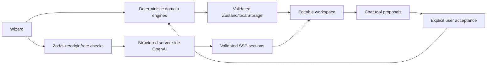

# Celebrate AI

An anonymous event planner for weddings, birthdays and community gatherings, with deterministic budgets and optional server-side AI personalization.

Production: https://celebrate-ai-event-planner.vercel.app

The latest local checks are recorded in [the follow-up quality report](../reports/submission-followup-2026-10-28.json). The previous release recorded 66/68 loads below two seconds with zero runtime/hydration errors; this follow-up requires fresh production verification. Earlier reports remain dated evidence.

## Follow-up local verification — 28 October 2026

**277/277 tests across 39 files**, **24/24 desktop/mobile browser checks**, strict TypeScript, lint/formatting, production build and bundle/secret checks passed. The full dependency audit reports zero findings. Whole-application line coverage is **82.17%**, library line coverage **94.78%**, and domain line coverage **98.35%**. The strengthened offline evaluation passes **46/46 cases with zero model calls**.

The inclusive coverage scope is app/components/lib/evals/middleware/public runtime JavaScript. Overall statements/branches/functions are 79.91%/75.88%/74.62%; only overall lines have an 80% gate. Library and domain gates still cover all four metrics.

Production verification for this follow-up is pending. The [previous release audit](../reports/verification-quality-final-2026-10-28.json) retained all 68 visits, 66 loads below two seconds and zero runtime/hydration errors; its strict timing gate failed.

## Run locally

```sh
npm ci
```

Copy `.env.example` to `.env.local`, then run `npm run dev` and visit http://localhost:3000. Node20.19+ is supported by the app; this workspace was verified on Node24. No test credentials or user accounts exist.

## Features

- Five-step, Zod/react-hook-form validated intake; city/country, date or horizon, ages, currency, dietary needs, style, ordered priorities, traditions, must-haves/avoid lists and event-specific details. Drafts autosave.
- Immediate deterministic plan, progressive SSE enhancement, one reconnect attempt, retry control, cancellation and edit-preserving updates.
- Budget donut and bar charts, exact whole-unit allocation, feasibility warnings, locked categories, contingency, per-guest/function costs, AI optimization preview and20-state undo/redo.
- Timeline dependency validation, critical path, GanttLite, overdue/ASAP warnings, pointer and keyboard phase ordering, editable status/date, multi-day run-of-show editor, calendar export.
- Vendor checklists, booking statuses/progress, custom categories/items, dietary safeguards, questions, red flags and contract requirements. No vendor directory or invented contact details.
- Diverse dietary-filtered ideas, saved/faceted filters, similar/cheaper/traditional/modern/surprise requests and regeneration previews.
- Grounded chat with structured tools for budgets, contingency, milestones, vendors, checklists and ideas. Every mutation requires acceptance; decisions persist and support undo. Text renders through sanitized Markdown.
- Local persistence with migration/validation, quota notices, JSON import/export, read-only compressed fragment sharing, full-plan print/PDF, persistent theme/currency and offline shell for saved plans.
- Local human feedback with reason tags and export. Reproducible 46-case evaluation dataset, adversarial cases, deterministic checks and dashboard. Live judging and repeated, blinded, position-swapped comparison tooling is implemented with resume/concurrency/cost caps; live quality results remain unmeasured.

## Environment

| Variable | Purpose |
| --- | --- |
| OPENAI_API_KEY | Server-only credential; absence/provider failure uses templates |
| OPENAI_MODEL | Default gpt-4o-mini |
| OPENAI_JUDGE_MODEL | Default gpt-4o, evaluation only |
| OPENAI_TIMEOUT_MS / OPENAI_MAX_RETRIES | Provider timeout and bounded SDK retries |
| EVAL_SECRET | Protects live mini-evaluations; never persisted by browser |
| UPSTASH_REDIS_REST_URL / UPSTASH_REDIS_REST_TOKEN | Optional shared rate/cache/token counters |
| DAILY_TOKEN_BUDGET | Daily token reservation limit; per-process without Upstash; default 2,000,000 |
| RATE_LIMIT_PER_MIN | Additional ceiling over per-route limits |
| NEXT_PUBLIC_APP_URL | Metadata origin |
| NEXT_PUBLIC_ENABLE_ANALYTICS | Optional analytics, false by default |

EVAL_SECRET protects mini evaluations and is configured separately from OPENAI_API_KEY; keep both server-only and out of committed files and issues. The 25 October production smoke verified a configured OpenAI key and one uncached schema-valid hybrid plan. The recorded production settings used gpt-4o-mini, zero automatic SDK retries, a 3-request/minute ceiling and a 50,000-token/day per-process budget. Provider failure or absent credentials still use the complete deterministic fallback. These records do not establish the current configuration of every deployment environment.

## Verification commands

| Command | Check |
| --- | --- |
| npm run typecheck | Strict TypeScript |
| npm run lint | Next/React/TypeScript lint |
| npm run test | Unit, component, API/MSW and race regressions |
| npm run test:coverage | V8 coverage and thresholds |
| npm run test:e2e | Desktop/mobile Chromium flows; local Windows uses installed Edge |
| npm run eval -- --suite=all --mock | Offline deterministic/adversarial evaluation |
| npm run eval -- --suite=judge --limit=5 --max-usd=2 | Live model/judge path; requires key |
| npm run build | Production compile and offline precache manifest |
| npm run audit:bundle | Browser secret scan and initial JS budget |
| npm run format:check | Prettier |
| vercel deploy --prod --yes --scope rohiths-projects-5e14931b | Redeploy existing project/alias |

The active `.github/workflows/ci.yml` includes typecheck, lint, coverage, offline evaluation, build, bundle audit and browser checks. Release run 40193415888 executed zero steps because GitHub reported an owner-account billing lock; hosted CI verification was not established. `reports/` records actual performance/bundle evidence; `evals/results/latest.json` is the historical 22 October (IST) offline snapshot. The 25 October runtime dependency audit recorded zero findings.

## Architecture and decisions



Money arithmetic never comes from the model. Prices are estimates, not quotations; currency selection chooses a unit and does not perform live FX conversion. Shared plans are copies in a URL fragment, not server records. Nonce CSP requires dynamic rendering per the installed Next.js guide. The final build aligns with the requested Next15 branch using15.5.28. PostCSS is overridden to the patched8.5.31 release. Nonce-based CSP requires dynamic rendering even on the landing page; this security choice prevents static HTML CDN caching. Page rendering runs on the Edge runtime globally; API functions remain in Mumbai (`bom1`).

## External prerequisites and measured limits

One live production generation was verified on 25 October, including observed tokens and latency and an estimated model cost. It does not establish live quality scores or a latency distribution. Live judges and prompt A/B quality comparisons remain unrun. The rubric anchors are provisional author-labelled examples, not independent human ratings. The offline historical baseline comparison measures actual domain fixes, not an isolated model prompt experiment.

Without Upstash credentials, serverless rate limits/cache/token accounting are best effort per process. Chat provider text is scanned before release to prevent fragmented secret-like output; streamed tool proposals still require acceptance. localStorage depends on available browser quota; export backups. Performance and accessibility claims are limited to the actual recorded audits, not an unconditional guarantee. Public repository: https://github.com/9059Rohith/celebrate-ai-event-planner. The earlier workflow-permission limitation was superseded by workflow activation; the recorded remaining CI blocker was the GitHub account billing lock.

See ARCHITECTURE.md, SECURITY.md and EVALUATION.md for contracts, threat model and measured results.

## Historical submission evidence — 22 October 2026

The 22 October 2026 offline evaluation passed 46/46 cases. That release's unit/component/API suite passed 113/113 tests. Library coverage was 91.53% lines, 89.51% statements, 83.31% branches and 88.73% functions; domain line coverage was 98.17%. The later 25 October results below supersede those counts. Coverage gates apply to `lib/**/*.ts`: 80% across all four measures and 90% for domain modules. Whole-application coverage and the master's 75% overall target are not established by these figures.

Browser checks include wedding, birthday and community planning, edits, persistence, JSON/calendar export, fragment sharing, offline editing, theme, evaluation drill-down, hydration and automated WCAG checks. Current release results are recorded in SUBMISSION.md after verification. Automated accessibility checks supplement manual keyboard testing; they do not certify every assistive-technology combination.

## Release and performance verification

Publish source before deploying: a subsequent Git push can replace the production alias with a different build. `npm run deploy:production` deploys to the existing project, warms critical assets, verifies every asset is a CDN HIT on a second request, and checks the release fingerprint. `npm run verify:production` runs 68 fresh-browser visits and fails for runtime/hydration errors, any load or heading readiness at/above 2 seconds, or a changed release. Set BROWSER_CHANNEL=msedge to select Edge explicitly and PERF_PHASE to name a report batch. Browser caches remain fresh; server/CDN state is warmed.

Previous audits, including failures, remain in reports/ and docs/performance-history.md. A prior batch passed 67/68 navigation loads with zero hydration errors, retaining one 4.830-second shared-page transfer outlier. LCP, navigation load, heading readiness and AI completion are different metrics. No arbitrary-network or all-device two-second guarantee is claimed.

The route hydration boundary has a regression using Next's vendored React renderer. It preserves the original server DOM and avoids the host-fiber replay failure documented in React issue 37584. Shared fragments use a stable server snapshot and are decoded after hydration; errors are not suppressed.

The release procedure uses the codex/submission-evidence branch for measurement reports to avoid replacing the measured production alias when publishing evidence. Identify the source commit, deployment and fingerprint in each report rather than assuming a moving alias still serves the measured release.


## Code quality revision — 25 October 2026

These are historical release results. A later successful signed-in inspection on 28 October confirmed the second submission scored 96.98/100, rank 53/51,556, with Code Quality 89 and Testing 99. Two of three attempts have been used. This supersedes the earlier PageNotFound observation; it does not establish a score for subsequent code changes.

- First portal attempt: 96.64/100, rank 67/51,309 (top 0.13% at observation). Code Quality was 88; this revision addresses source-level findings rather than asserting an unmeasured new score.
- Replaced evaluation double assertions with a validated dashboard summary contract. Invalid custom evaluation events are ignored.
- Extracted plan actions and chat lifecycle into focused hooks; centralized UI persistence on the existing safe storage adapter. Chat resets when changing plans, cancels abandoned requests, and saves completed responses without writing storage for every token.
- Formatting is enforced through npm run lint, already invoked by GitHub Actions. Generated summaries retain formatting after builds.
- 135/135 unit, component and API tests pass, including 22 additional sharing, storage, evaluation-contract and hook regressions. Library coverage: statements 91.16%, branches 83.75%, functions 92.87%, lines 92.99%. The new hooks are included in this scope; domain lines remain 98.17%.
- Offline evaluation: 46/46, no model calls. Production dependency audit: zero reported vulnerabilities.
- Test execution is capped at two workers to reduce resource contention on constrained hosts.
- Final production build and bundle audit pass: initial modern-browser home JavaScript is 117,623 gzipped bytes against a 122,880-byte budget; browser bundle secret scan passed.
- Final desktop/mobile browser suite: 20/20 passed, covering all occasions, editing, exports, shared-fragment hydration, offline editing, theme/currency, CSP headers and automated accessibility. Final TypeScript, ESLint and formatting checks passed.
- Push f40fd79 triggered GitHub Actions run 40193415888. The verify job executed zero steps because GitHub reported the owner account is locked due to a billing issue. Local results are reported separately from this hosted CI blocker.
- Production deployment dpl_HUyMGmZFQUVZaQqG8S1LvUFKgCAM is READY at the original alias; health returns HTTP 200 with aiConfigured true.
- Production timing verification retained every sample and confirmed a stable release fingerprint. Bundled Chromium 156: 68 samples, 63 loads under two seconds, median 991.5 ms, p95 3741.8 ms, maximum 26135.9 ms, zero runtime/hydration errors. The largest stall occurred before static requests were sent.
- Comparison in Edge 156: 68 samples, 66 loads under two seconds, median 998.8 ms, p95 1442.7 ms, maximum 2342.2 ms, zero runtime/hydration errors. Two samples exceeded two seconds.
- The strict performance gate did not pass in either browser; these observations do not support a claim that every page always loads under two seconds. Both raw report sets and summaries are committed. No additional model calls were made for this revision.
