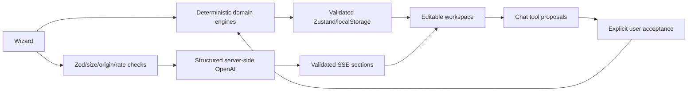

# Celebrate AI

An anonymous event planner for weddings, birthdays and community gatherings, with deterministic budgets and optional server-side AI personalization.

Production: https://celebrate-ai-event-planner.vercel.app

## Run locally

```sh
npm ci
```

Copy `.env.example` to `.env.local`, then run `npm run dev` and visit http://localhost:3000. Node20.19+ is supported by the app; this workspace was verified on Node24. No test credentials or user accounts exist.

## Features

- Five-step, Zod/react-hook-form validated intake; city/country, date or horizon, ages, currency, dietary needs, style, ordered priorities, traditions, must-haves/avoid lists and event-specific details. Drafts autosave.
- Immediate deterministic plan, progressive SSE enhancement, one reconnect attempt, retry control, cancellation and edit-preserving updates.
- Budget donut and bar charts, exact whole-unit allocation, feasibility warnings, locked categories, contingency, per-guest/function costs, AI optimization preview and20-state undo/redo.
- Timeline dependency validation, critical path, GanttLite, overdue/ASAP warnings, pointer and keyboard phase ordering, editable status/date, multi-day run-of-show editor, calendar export.
- Vendor checklists, booking statuses/progress, custom categories/items, dietary safeguards, questions, red flags and contract requirements. No vendor directory or invented contact details.
- Diverse dietary-filtered ideas, saved/faceted filters, similar/cheaper/traditional/modern/surprise requests and regeneration previews.
- Grounded chat with structured tools for budgets, contingency, milestones, vendors, checklists and ideas. Every mutation requires acceptance; decisions persist and support undo. Text renders through sanitized Markdown.
- Local persistence with migration/validation, quota notices, JSON import/export, read-only compressed fragment sharing, full-plan print/PDF, persistent theme/currency and offline shell for saved plans.
- Local human feedback with reason tags and export. Reproducible46-case evaluation dataset, adversarial cases, deterministic checks, live judges, repeated/blind position-swapped comparisons, resume/concurrency/cost caps and dashboard.

## Environment

| Variable | Purpose |
| --- | --- |
| OPENAI_API_KEY | Server-only credential; absence/provider failure uses templates |
| OPENAI_MODEL | Default gpt-4o-mini |
| OPENAI_JUDGE_MODEL | Default gpt-4o, evaluation only |
| OPENAI_TIMEOUT_MS / OPENAI_MAX_RETRIES | Provider timeout and bounded SDK retries |
| EVAL_SECRET | Protects live mini-evaluations; never persisted by browser |
| UPSTASH_REDIS_REST_URL / UPSTASH_REDIS_REST_TOKEN | Optional shared rate/cache/token counters |
| DAILY_TOKEN_BUDGET | Global daily reservation limit; default2000000 |
| RATE_LIMIT_PER_MIN | Additional ceiling over per-route limits |
| NEXT_PUBLIC_APP_URL | Metadata origin |
| NEXT_PUBLIC_ENABLE_ANALYTICS | Optional analytics, false by default |

Production and Preview have a generated evaluation secret. Its local copy is in ignored `.env.local`; never commit or paste it into an issue. The OpenAI key has not been supplied, so the published app uses its complete deterministic fallback. No key is fabricated or reused from another project.

## Verification commands

| Command | Check |
| --- | --- |
| npm run typecheck | Strict TypeScript |
| npm run lint | Next/React/TypeScript lint |
| npm run test | Unit, component, API/MSW and race regressions |
| npm run test:coverage | V8 coverage and thresholds |
| npm run test:e2e | Desktop/mobile Chromium flows; local Windows uses installed Edge |
| npm run eval -- --suite=all --mock | Offline deterministic/adversarial evaluation |
| npm run eval -- --suite=judge --limit=5 --max-usd=2 | Live model/judge path; requires key |
| npm run build | Production compile and offline precache manifest |
| npm run audit:bundle | Browser secret scan and initial JS budget |
| npm run format:check | Prettier |
| vercel deploy --prod --yes --scope rohiths-projects-5e14931b | Redeploy existing project/alias |

The CI template includes typecheck, lint, coverage, offline evaluation, build, bundle audit and browser checks; see the activation limitation below. `reports/` records actual performance/bundle evidence; `evals/results/latest.json` records actual offline results. Runtime dependency audit has no vulnerabilities.

## Architecture and decisions



Money arithmetic never comes from the model. Prices are estimates, not quotations; currency selection chooses a unit and does not perform live FX conversion. Shared plans are copies in a URL fragment, not server records. Nonce CSP requires dynamic rendering per the installed Next.js guide. The final build aligns with the requested Next15 branch using15.5.28. PostCSS is overridden to the patched8.5.31 release. Nonce-based CSP requires dynamic rendering even on the landing page; this security choice prevents static HTML CDN caching. Page rendering runs on the Edge runtime globally; API functions remain in Mumbai (`bom1`).

## External prerequisites and measured limits

Live AI quality, judge scores, prompt A/B quality gains, paid cost and model latency cannot be certified without a supplied OpenAI key. The rubric anchors are provisional author-labelled examples, not independent human ratings. The offline historical baseline comparison measures actual domain fixes, not an isolated model prompt experiment.

Without Upstash credentials, serverless rate limits/cache/token accounting are best effort per process. Chat provider text is scanned before release to prevent fragmented secret-like output; streamed tool proposals still require acceptance. localStorage depends on available browser quota; export backups. Performance and accessibility claims are limited to the actual recorded audits, not an unconditional100% guarantee. Public repository: https://github.com/9059Rohith/celebrate-ai-event-planner. The saved GitHub OAuth credential lacks workflow scope, so the CI definition is published as ci/github-actions.yml rather than an active workflow. The complete local .github/workflows/ci.yml is retained; uploading it needs workflow permission.

See ARCHITECTURE.md, SECURITY.md and EVALUATION.md for contracts, threat model and measured results.

## Verified submission evidence

The 22 October 2026 offline evaluation passed 46/46 cases. The current unit/component/API suite passed 113/113 tests. Library coverage is 91.53% lines, 89.51% statements, 83.31% branches and 88.73% functions; domain line coverage is 98.17%. The coverage gate requires 80% overall and 90% for domain modules across all four measures. These figures do not represent whole-application coverage.

Browser checks include wedding, birthday and community planning, edits, persistence, JSON/calendar export, fragment sharing, offline editing, theme, evaluation drill-down, hydration and automated WCAG checks. Current release results are recorded in SUBMISSION.md after verification. Automated accessibility checks supplement manual keyboard testing; they do not certify every assistive-technology combination.

## Release and performance verification

Publish source before deploying: a subsequent Git push can replace the production alias with a different build. `npm run deploy:production` deploys to the existing project, warms critical assets, verifies every asset is a CDN HIT on a second request, and checks the release fingerprint. `npm run verify:production` runs 68 fresh-browser visits and fails for runtime/hydration errors, any load or heading readiness at/above 2 seconds, or a changed release. Set BROWSER_CHANNEL=msedge to select Edge explicitly and PERF_PHASE to name a report batch. Browser caches remain fresh; server/CDN state is warmed.

Previous audits, including failures, remain in reports/ and docs/performance-history.md. A prior batch passed 67/68 navigation loads with zero hydration errors, retaining one 4.830-second shared-page transfer outlier. LCP, navigation load, heading readiness and AI completion are different metrics. No arbitrary-network or all-device two-second guarantee is claimed.

The route hydration boundary has a regression using Next's vendored React renderer. It preserves the original server DOM and avoids the host-fiber replay failure documented in React issue 37584. Shared fragments use a stable server snapshot and are decoded after hydration; errors are not suppressed.

Final deployment reports are published on the codex/submission-evidence branch after measurements, so publishing evidence does not replace the measured production alias.
